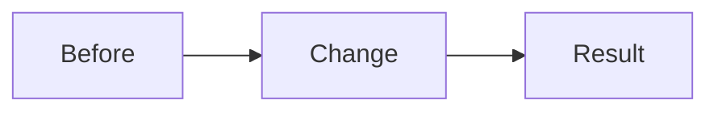

## What

## Why

## How

## Diagram

## How to test

## Files changed

## Objectives achieved

- [ ]

---

## Español

### Qué

### Por qué

### Cómo

### Diagrama

Consulta el diagrama Mermaid anterior.

### Cómo probarlo

### Archivos modificados

### Objetivos cumplidos

- [ ]
