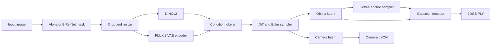

# Upstream architecture and tensor map

This map describes the reference SDK at
[commit 4702a7f00850e34b6e83a2170cc123c3e9570744](https://github.com/speridlabs/idol-sdk/tree/4702a7f00850e34b6e83a2170cc123c3e9570744)
and the public Idol [config.json](https://huggingface.co/speridlabs/idol/blob/main/config.json)
observed on 2026-10-30. The model URL points to a mutable branch; pin its
revision before producing numerical reference artifacts. This is a source and
configuration inventory, not a validated MLX implementation.

## Data flow

The original Python entry point is `IdolPipeline` in
[`idol/pipeline.py`](https://github.com/speridlabs/idol-sdk/blob/4702a7f00850e34b6e83a2170cc123c3e9570744/idol/pipeline.py).
It chooses CUDA when available and otherwise CPU; the CUDA-only optimization
path uses compilation, batched guidance, cuDNN attention and TF32. It does not
automatically select Apple MPS. The MLX backend remains to be implemented.

## Tensor contracts

Here `B` is batch size, `L` the common condition-token length, `P` the
number of occupied octree parents at a level, `A` the number of anchors and
`G=32A` the number of output Gaussians for this configuration.

| Stage | Input | Output and handling |
| --- | --- | --- |
| Preprocessing | Image, optional alpha | RGB image resized to 1024 × 1024. Existing nontrivial alpha may skip background removal; otherwise BiRefNet supplies a mask. Crop margin depends on input mode. |
| Pixel tensor | Prepared image | PyTorch `[B, 3, 1024, 1024]` float values in [0, 1]; the pipeline uses B=1. |
| DINOv3 | ImageNet-normalized pixel tensor | `feature1 [B, L, 1280]`, last hidden state cast to FP32 and layer-normalized. DINO model defaults to BF16; FP32 is configurable. |
| FLUX.2 VAE | Pixel tensor scaled to [-1, 1] and cast to BF16 | A sampled VAE latent is packed in 2 × 2 patches, normalized using VAE running statistics, flattened to `[B, L-5, 128]`, cast to FP32 and prefixed with five zero tokens: `feature2 [B, L, 128]`. |
| DiT | Noise `latent [B, 8192, 16]`, `camera [B, 1, 5]`, time `[B]` and both features | Returns velocity tensors matching the latent and camera shapes. Feature sequences must have the same L because their projections are added. |
| Euler sampler | Initial noise and conditional / zero conditions | Iterates from t=1 to 0 with time rescaling; model receives 1000 × t. Classifier-free guidance uses `(1+w)*v_cond - w*v_uncond`; default 50 steps, w=3, shift=3. |
| Octree network | Cell centers `[B, P, 3]`, level `[B]`, latent `[B, 8192, 16]` | Eight child logits `[B, P, 8]`. Systematic sampling and packing place anchors `[B, A, 3]`; the configured maximum level is 8. |
| Gaussian decoder | Anchors `[B, A, 3]` and object latent | Raw features `[B, A, 480]`, i.e. 32 × 15 values per anchor, then Gaussian attributes for G points. |
| Output | Gaussian attributes and camera latent | PLY stores positions, zero normals, DC color, inverse-activated opacity, log scale and quaternion. The exporter transforms z-up coordinates to y-up. Camera JSON contains yaw, pitch, radius and field of view. |

The DINO and VAE models are gated. The exact runtime L, encoder behavior and
all tensor shapes must be checked with approved weights and captured reference
tensors; do not treat source-level contracts as measured parity.

## Precision and stochastic operations

- The reference constructs DiT and decoder transformer-block linear parameters
  in FP16; embeddings and some normalization operations use FP32. The precise
  casts are in the source and should be checked at every ported boundary.
- BiRefNet is converted to FP16 only on CUDA. The VAE is loaded in BF16;
  DINO defaults to BF16. Device support and numerical behavior on Apple
  Silicon must be measured separately.
- Noise generation, VAE posterior sampling, systematic octree sampling and
  leaf-cell jitter are stochastic. A seed alone does not guarantee identical
  random sequences across frameworks. Save and reuse explicit inputs or noise
  for component comparisons.

## Model configuration and weight inventory

| Model | Configuration observed | Reference weight source | Representative state-dict names |
| --- | --- | --- | --- |
| DiT | width 1024; 24 joint and 2 refiner blocks; 16 heads | `denoiser.safetensors` | `pos_pe`, `input_layer.weight`, `cond_embedder.weight`, `cond_embedder2.weight`, `shift_table`, `out_layer.weight`, `cam_out_layer.weight` |
| Octree | width 1024; 4 blocks; 16 heads; latent width 16 | `decoder.safetensors` | `in_proj.weight`, `input_layer.weight`, `out_proj.weight`, `blocks.*` |
| Gaussian decoder | width 1024; 16 blocks; 16 heads; 32 Gaussians per anchor | `decoder_gs.safetensors` | `points_offset_perturbation`, `base_offset_scale`, `in_proj.weight`, `out_proj.weight`, `blocks.*` |
| Segmentation | BiRefNet | `birefnet.safetensors` | Inspect the checkpoint and `idol/models/birefnet.py` before mapping; its deformable convolution is a porting risk. |
| Image encoders | DINOv3 ViT-H+ and FLUX.2 VAE | Separate Hugging Face repositories; see [model access](model-access.md) | Their checkpoint names and conversion mappings require separate inspection. |

Names above are examples derived from module attributes, not a complete audited
checkpoint manifest. `blocks.*` denotes a family of names, not a literal key.
Use strict key and shape checks when designing the converter, including persistent
buffers; inspect convolution layouts before changing them.

## Migration risks and verification

1. Port shared attention, FP32 normalization and RePo/RoPE with controlled
   inputs before testing the full DiT.
2. Validate VAE packing, batch-normalization statistics and feature alignment;
   preserve posterior randomness in parity tests.
3. Prototype octree variable-size packing, search and scatter operations before
   optimizing memory or batching.
4. Evaluate a correct equivalent for BiRefNet's
   `torchvision.ops.deform_conv2d`; an existing alpha channel provides an
   independent path for early pipeline validation.
5. Check license and access conditions before adapting or redistributing model
   components; do not commit tokens, private paths, or model weights.

Spanish: [es/architecture.md](../es/architecture.md).
