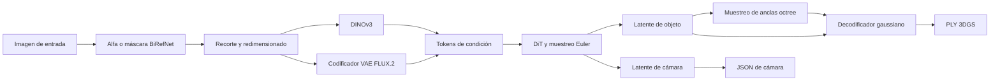

# Arquitectura y mapa de tensores del proyecto original

Este mapa describe el SDK de referencia en el
[commit 4702a7f00850e34b6e83a2170cc123c3e9570744](https://github.com/speridlabs/idol-sdk/tree/4702a7f00850e34b6e83a2170cc123c3e9570744)
y el [config.json público](https://huggingface.co/speridlabs/idol/blob/main/config.json)
observado el 30 de octubre de 2026. La URL del modelo apunta a una rama que puede
cambiar; fija su revisión antes de generar referencias numéricas. Esto es un
inventario de código y configuración, no una implementación MLX validada.

## Flujo de datos

El punto de entrada es `IdolPipeline` en
[`idol/pipeline.py`](https://github.com/speridlabs/idol-sdk/blob/4702a7f00850e34b6e83a2170cc123c3e9570744/idol/pipeline.py).
Selecciona CUDA si está disponible y CPU en caso contrario; la optimización
exclusiva de CUDA usa compilación, guidance por lotes, atención cuDNN y TF32.
No selecciona MPS automáticamente. El backend MLX aún está pendiente.

## Contratos de tensores

`B` es el lote, `L` la longitud común de los tokens de condición, `P` los
nodos padre ocupados, `A` las anclas y `G=32A` las Gaussianas de salida.

| Etapa | Entrada | Salida y tratamiento |
| --- | --- | --- |
| Preprocesamiento | Imagen, alfa opcional | Imagen RGB de 1024 × 1024. Un alfa no trivial puede evitar la eliminación de fondo; en caso contrario BiRefNet genera la máscara. El margen depende del modo. |
| Tensor de píxeles | Imagen preparada | Tensor PyTorch `[B, 3, 1024, 1024]` con valores flotantes en [0, 1]; el pipeline usa B=1. |
| DINOv3 | Píxeles normalizados con ImageNet | `feature1 [B, L, 1280]`, último estado convertido a FP32 y normalizado. El modelo usa BF16 por defecto; FP32 es configurable. |
| VAE FLUX.2 | Píxeles en [-1, 1], convertidos a BF16 | Se muestrea el latente, se empaqueta en parches 2 × 2, se normaliza con estadísticas del VAE, se aplana a `[B, L-5, 128]`, se convierte a FP32 y se anteponen cinco tokens de ceros: `feature2 [B, L, 128]`. |
| DiT | Ruido `latent [B, 8192, 16]`, `camera [B, 1, 5]`, tiempo `[B]` y dos características | Devuelve velocidades con las mismas formas que latente y cámara. Las secuencias de características deben compartir L porque sus proyecciones se suman. |
| Muestreo Euler | Ruido inicial y condiciones positivas y de ceros | Itera de t=1 a 0 con reescalado; el modelo recibe 1000 × t. Guidance: `(1+w)*v_cond - w*v_uncond`; por defecto 50 pasos, w=3 y desplazamiento=3. |
| Red octree | Centros `[B, P, 3]`, nivel `[B]` y latente `[B, 8192, 16]` | Ocho logits hijos `[B, P, 8]`. El muestreo sistemático y empaquetado producen anclas `[B, A, 3]`; nivel máximo configurado 8. |
| Decodificador gaussiano | Anclas `[B, A, 3]` y latente | Características `[B, A, 480]`, es decir 32 × 15 valores por ancla, y después atributos de G Gaussianas. |
| Salida | Atributos y latente de cámara | El PLY guarda posición, normales cero, color DC, opacidad con activación inversa, logaritmo de escala y cuaternión. El exportador transforma z-up a y-up. El JSON contiene yaw, pitch, radio y campo de visión. |

Los dos encoders requieren acceso restringido. La longitud L, el comportamiento
y las formas reales deben comprobarse con pesos autorizados y tensores de
referencia; los contratos del código no demuestran equivalencia numérica.

## Precisión y aleatoriedad

- El original construye las capas lineales de los bloques transformer del DiT y
  los decodificadores en FP16; embeddings y algunas normalizaciones usan FP32.
  Consulta las conversiones de cada límite en el código.
- BiRefNet pasa a FP16 solo en CUDA. El VAE se carga en BF16; DINO usa BF16 por
  defecto. El soporte del dispositivo y el comportamiento numérico deben medirse
  por separado en Apple Silicon.
- El ruido, muestreo del VAE, muestreo sistemático octree y perturbación dentro
  de la celda son aleatorios. La misma semilla no garantiza secuencias idénticas
  entre frameworks; comparte entradas o ruido explícitos al comparar componentes.

## Configuración e inventario de pesos

| Modelo | Configuración observada | Pesos de referencia | Ejemplos de nombres del state dict |
| --- | --- | --- | --- |
| DiT | ancho 1024; 24 bloques conjuntos y 2 de refinamiento; 16 cabezas | `denoiser.safetensors` | `pos_pe`, `input_layer.weight`, `cond_embedder.weight`, `cond_embedder2.weight`, `shift_table`, `out_layer.weight`, `cam_out_layer.weight` |
| Octree | ancho 1024; 4 bloques; 16 cabezas; latente 16 | `decoder.safetensors` | `in_proj.weight`, `input_layer.weight`, `out_proj.weight`, `blocks.*` |
| Decodificador gaussiano | ancho 1024; 16 bloques; 16 cabezas; 32 Gaussianas por ancla | `decoder_gs.safetensors` | `points_offset_perturbation`, `base_offset_scale`, `in_proj.weight`, `out_proj.weight`, `blocks.*` |
| Segmentación | BiRefNet | `birefnet.safetensors` | Inspeccionar el checkpoint y `idol/models/birefnet.py`; la convolución deformable es un riesgo. |
| Encoders de imagen | DINOv3 ViT-H+ y VAE FLUX.2 | Repositorios separados de Hugging Face; consulta [acceso a modelos](model-access.md) | Los nombres de pesos y mapeos necesitan inspección independiente. |

Los nombres son ejemplos derivados de los atributos de los módulos, no un
inventario completo de los checkpoints. `blocks.*` representa una familia de
nombres, no una clave literal. El conversor debe validar claves y formas de
manera estricta, incluyendo buffers persistentes y disposición de convoluciones.

## Riesgos y verificación

1. Portar atención, normalización FP32 y RePo/RoPE con entradas controladas antes
   de probar el DiT completo.
2. Validar empaquetado del VAE, estadísticas y alineación de características,
   controlando la aleatoriedad en las comparaciones.
3. Prototipar empaquetado de tamaño variable, búsqueda y scatter del octree
   antes de optimizar memoria o lotes.
4. Evaluar un equivalente correcto para `torchvision.ops.deform_conv2d`; un
   alfa existente permite validar antes el resto del pipeline.
5. Revisar licencias y acceso antes de adaptar o redistribuir componentes; no
   incluir tokens, rutas privadas ni pesos en el repositorio.

Versión principal: [docs/architecture.md](../docs/architecture.md).
